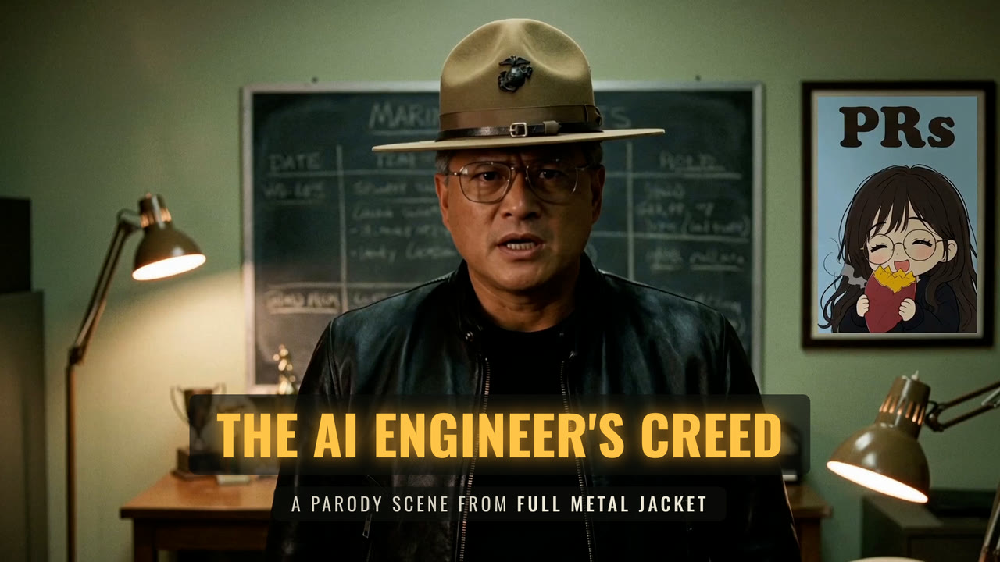

# The AI Engineer's Creed

> Full Metal Jacket's barracks creed, recast for AI engineering: "This is my software factory."

**[Watch the spin-off: the McGurk effect in AI lip sync](https://youtu.be/-VAw_z6oKpQ)**

AI engineers on X are the recruits and Jensen Huang is the drill instructor. Every line is rewritten to fit the original's timing, then performed again: the recruits' creed is one sung chorus take (Eleven Music), and Jensen's orders are a voice clone (Fish Audio). There are two cuts:

- **Lip sync:** the film's own footage, with every mouth re-synced to the new lines (Fal Sync-3).
- **Fully generative:** every shot remade with the cast (Nano Banana Pro keyframes, H3 Max animation), with a title card, word-timed captions and end credits rendered locally in [HyperFrames](https://hyperframes.heygen.com).

Status: both cuts are rendered. The lip sync cut runs 68.6 s; the fully generative cut runs 76.1 s, including captions and credits. Built with Claude Code (Opus 5.5).

## License

The code is [MIT](license) © [Travis Fischer](https://x.com/transitive_bs). The film, its footage, audio and dialogue belong to their rights holders and are not included. Nor are the cast's photos and voice references, or any renders. The cast are real people, portrayed affectionately in parody.

---

Want to run it, change it, or see where everything lives? See [contributing.md](contributing.md).
